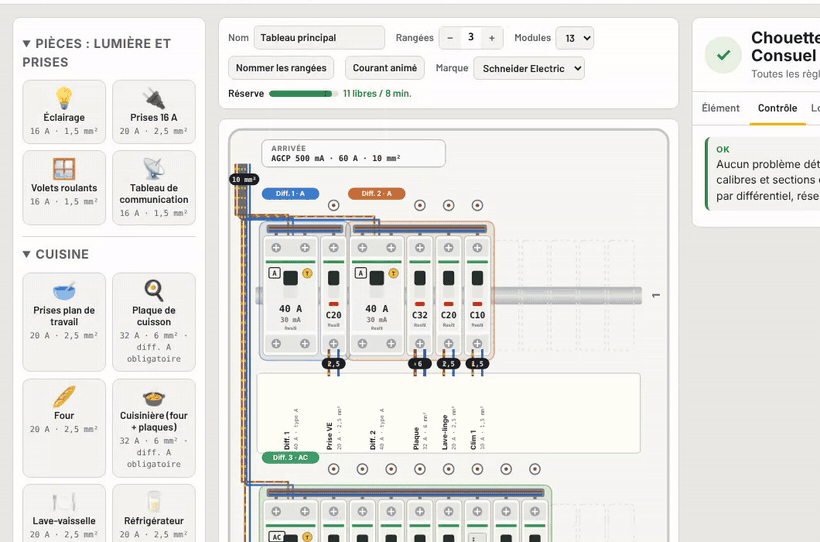

  

## Mes projets

<h3> Chouette Tableau</h3>

Dessiner son tableau électrique en glissant les disjoncteurs.
Il vérifie la norme NF C 15-100 au fur et à mesure, dit ce que le Consuel refuserait et pourquoi, puis sort le PDF et la liste de matériel.
Ça s’ouvre dans le navigateur, sans compte.

  
  

<h3> Empreinte</h3>

Savoir ce que consomme chaque appareil de la maison avec un seul capteur, le compteur Linky.
Une intégration Home Assistant qui reconnaît le four, la bouilloire ou le lave-vaisselle quand ils s’allument.
100 % locale : rien ne sort de chez toi.

  
  
  

---

**Ton avis m’intéresse.** Les critiques sont bienvenues, tant qu’elles aident à apprendre.
Une idée, un bug, un conseil ? Ouvre une issue sur le projet concerné, ou écris-moi.

